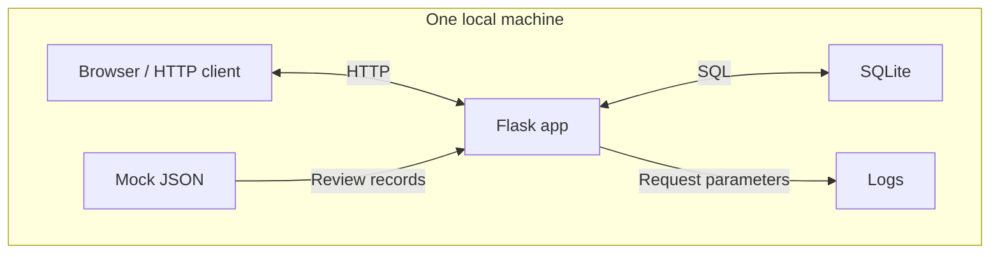
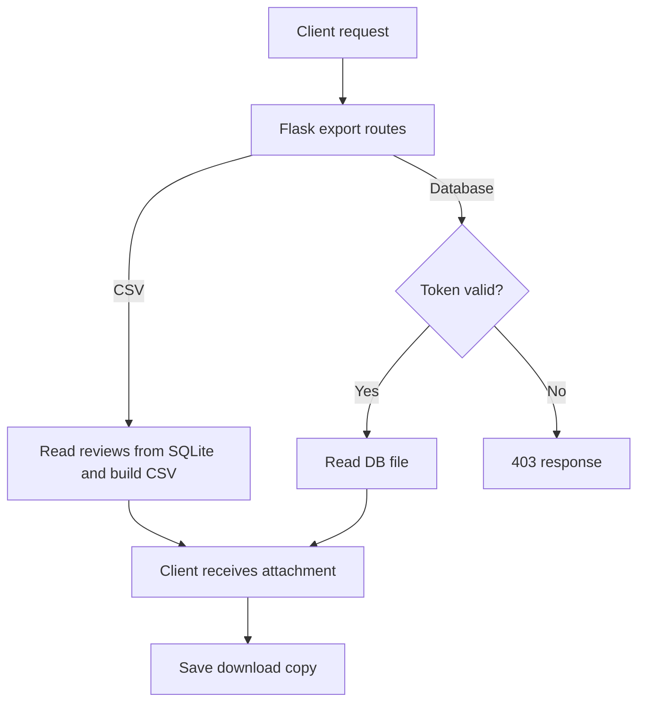

# System Understanding and Initial Security Analysis

Sciencia AI Review Intelligence Sandbox  
Author: Phoebe Zhang

## 1. System overview and scope

This application is a local teaching sandbox for importing, searching, summarizing,
and exporting sample app reviews. A browser displays application choices and
stored review counts. Users submit imports through forms and access JSON
responses, statistics, ingestion history, and downloads through HTTP endpoints.

Flask connects these requests to a local provider JSON file and a SQLite database.
The provider is a mock data source, not an external API. Statistics are review
counts, average ratings, and word frequencies, not AI sentiment classification.
All components are local; the application does not need a cloud service or a
separate database server.

This analysis draws on current source code, initial manual observations, and
recorded automated verification of normal local operations. No active exploitation
was performed. Functional success does not establish security. The main concerns
are client input entering SQL, unclear caller and export permissions, and the
export token appearing in logs. These concerns follow from the system's data
flows rather than demonstrated attacks.

## 2. Architecture and main data flows

An import sends an `app_id`, not review text, from the client. The backend reads
that application's records from JSON, inserts the application and new reviews,
and records the import outcome. These writes share a transaction. Repeated
imports leave existing review IDs unchanged but add another history record;
review content and ingestion history therefore have different meanings.

Queries, statistics, and history read SQLite and return JSON. The homepage reads
stored counts and renders HTML; CSS is requested separately. Search supports
application and text filters. Statistics are calculated from stored ratings and
text. Request logging independently captures paths and query parameters, including
parameters unrelated to the returned data.

Exports cross from stored data to a client-controlled copy. Their permission
checks differ:

CSV is generated in memory from all review rows, regardless of earlier search
filters. Database export sends the whole SQLite file, including app mappings and
import history, after checking the demo token. Both are HTTP attachments saved
by the client, not files created directly in a server download folder. Diagram
boundaries describe logical roles and data movement; they do not imply implemented
network or process security isolation.

## 3. Components, access points, and protected information

| Component | Key location | Responsibility |
|---|---|---|
| Flask application | `app/app.py` | Request handling, imports, queries, statistics, exports, and logging. |
| Browser interface | `app/templates/index.html`, `app/static/style.css` | Import forms, stored counts, and page presentation. |
| Mock provider | `data/provider_reviews.json` | Supplies synthetic review records grouped by application. |
| Database access and schema | `app/db.py` | Connections, foreign-key checks, and table creation. |
| SQLite storage | `data/reviews.db` | Applications, reviews, and ingestion history. |
| Configuration | `app/config.py` | Demo secret/token, debug flag, and request-logging flag. |
| Runtime log | `logs/app.log` | Request details and observed server startup/access records. |

The `apps` table identifies applications. Each `reviews` row belongs to an app
and contains rating, text, dates, version, and region metadata. `ingestion_runs`
records operations, including fetched and inserted counts and status. Both latter
tables reference `apps`; review IDs are unique across the reviews table. Repeating
an import can add history without adding reviews (`app/db.py`, `ingest()`).

The direct entry point binds to `127.0.0.1:5000`. Loopback limits network
reachability; it does not authenticate the person or process making a request.

| HTTP entry | Purpose and input | Existing access check |
|---|---|---|
| `GET /`, `/static/style.css` | Homepage and CSS; no required input. | No login check. |
| `POST /ingest` | Import using form `app_id`. | Requires POST and an existing provider key; no caller authorization check. |
| `GET /reviews` | Optional `app_id` and text keyword `q`; newest reviews, limit 200. | No login or per-app permission check. |
| `GET /analysis/summary` | Statistics for optional `app_id`, or all reviews. | No login check. |
| `GET /admin/runs` | Latest 100 import-history records. | No administrator check. |
| `GET /export.csv` | Download all review rows, including ingestion timestamps. | No login or token check. |
| `GET /export.db` | Download the entire database using query parameter `token`. | Equality with the configured demo token; otherwise 403 in source code. |
| `GET /health` | Status and UTC time. | No login; does not check database readiness. |

POST acceptance identifies a request method, not an authorized user. Likewise,
a valid provider key confirms data availability, not permission to import it.
The `/admin` name provides no administrator protection.

Protected information includes review integrity, app mappings, accurate import
history, the SQLite file, and exported copies. Current records are synthetic
teaching data, not real customer information. The configuration explicitly marks
`APP_SECRET` and `INTERNAL_EXPORT_TOKEN` as demo values. `APP_SECRET` sets Flask's
secret key, but no route implements a session-based login. There is no evidence
of real provider API keys, user passwords, or cloud credentials.

Logs also need controlled access because query parameters can contain the export
token. Secret and token values should not be copied into shared evidence;
existing evidence redacts the token and other configured secret values.

## 4. Trust boundaries and security reasoning

| Boundary | Check, assumption, and possible consequence |
|---|---|
| Client input → backend and SQL | Routes accept form/query values. Provider-key lookup checks import selection, while search interpolates values into SQL. Assuming all callers supply harmless values could allow query errors or unintended query behavior. |
| Provider file → application and database | JSON parsing, expected field access, primary keys, and enabled foreign keys provide limited checks. The application assumes the file's contents and writers are trusted. Missing or invalid fields could break imports or create unreliable data. |
| Application → local files | The process reads configuration/provider data and writes SQLite/logs. Access depends on OS permissions; the application sets no explicit restrictive file-permission policy. A local reader can obtain the database without the HTTP export-token check; a writer could alter it. |
| Stored data → export recipient | CSV has no authorization check; database export checks one demo token. The design assumes eligible local callers and acceptable whole-file disclosure. If those assumptions fail, data can reach unintended recipients or persist in uncontrolled copies. |
| Request parameters → logs | Enabled logging records query values without redaction in the application. It assumes raw logs remain restricted. A value used to authorize export can consequently become available through a different access path. |

Local deployment reduces network exposure but does not make every local caller,
file writer, or log reader trusted. These are changes in data or authority,
not separate security boundaries for every internal function call.

## 5. Initial security risks and investigation questions

**Search input can enter SQL structure.** In `reviews()` (`app/app.py`), both
filters are interpolated into the SQL string. In contrast, ingestion and the
summary's app filter use bound parameters. This inconsistent separation of data
and SQL crosses the client-input boundary. If input changes SQL interpretation,
queries could fail or return unintended records. Specific SQL-injection
exploitability has not been verified. Can these filters use bound parameters
while preserving the intended search behavior?

**The local-user permission model is implicit.** Import, history, statistics,
and CSV routes lack login or role checks, and the import form has no CSRF token
(`app/app.py`, `index.html`). A single learner may intentionally use this open
model, but several local users or browser contexts may require different controls.
Unexpected requests could change import history or retrieve stored information.
Who is allowed to use each operation, and should CSV and whole-database export
have equivalent restrictions? Missing controls alone do not demonstrate a remote
attack.

**The export credential also becomes log data.** `export_db()` compares a fixed
query token, while `record_request()` logs query arguments when
`LOG_REQUEST_DETAILS` is enabled. Normal operation confirmed that the token enters
raw logs; server access records also include its URL. A log reader could learn
the value and, if able to reach the service, reuse it for export. This is an
observed confidentiality concern involving a demo value, not evidence of real
customer-data leakage. How should export authorization and log redaction protect
the credential across both the request and its recorded copies?

**Provider validation and import policy need definition.** `ingest()` expects
particular fields without full schema validation. `app/db.py` defines no
rating-range or date-format check. Existing review IDs are ignored rather than
updated, and exceptions have no separate failed-run history handler. Unexpected
data could fail ingestion, retain outdated content, or leave failures absent from
history. Which input rules, duplicate/update behavior, and failure records are
required? The provider is local today, but its file remains an input boundary.

**Debug and filesystem access rely on teaching-environment assumptions.**
`app/config.py` enables debug; `app/app.py` uses the development server. Local files
hold the database, demo configuration, and logs without application-enforced
file permissions. Broader local access or reuse in a shared setting could expose
diagnostics, stored data, or credentials. Confirm who can read/write these files
and whether debug should remain enabled under the intended use model. This is
not a claim that the current files are publicly readable.

Secondary questions concern CSV spreadsheet interpretation, export size and
memory use, dependency version reproducibility, and retention of logs/history
and downloaded copies. These deserve attention if usage grows, without displacing
the clearer input, authorization, and credential-flow concerns above.

The next stage should first clarify intended users and export permissions, then
review SQL input handling and credential logging, followed by provider/update and
failure policies. These priorities follow where client input becomes a database
query and where stored data or authorization values leave their original context.

Normal-operation methods, results, and evidence are documented in
[Verification Results](verification-results.md).
